# Transaction Ledger API

> A small, deliberately explicit financial ledger service built to show how account balances, immutable transaction history, idempotency, and MongoDB transactions fit together.


This repository is an API-only technical assessment. It intentionally keeps the system understandable: one Express application, one MongoDB replica set, explicit service-layer financial mutations, and no external queue or payment provider.

## Table of contents

- [1. What are we building?](#1-what-are-we-building)
- [2. Quick start](#2-quick-start)
- [3. Architecture overview](#3-architecture-overview)
- [4. Folder structure](#4-folder-structure)
- [5. Database design](#5-database-design)
- [6. Complete API reference](#6-complete-api-reference)
- [7. Credit journey](#7-journey-of-a-credit-transaction)
- [8. Debit journey](#8-journey-of-a-debit-transaction)
- [9. Duplicate prevention](#9-how-duplicate-prevention-works)
- [10. Atomicity](#10-how-atomicity-works)
- [11. Concurrency](#11-how-concurrency-works)
- [12. History and pagination](#12-transaction-history-and-pagination)
- [13. Transfers](#13-account-to-account-transfer)
- [14. Money precision](#14-money-precision)
- [15. Validation and errors](#15-validation-and-error-handling)
- [16. Swagger](#16-swagger-walkthrough)
- [17. Testing](#17-testing-strategy)
- [18. Docker and replica sets](#18-docker-and-mongodb-replica-set)
- [19. Indexes and migrations](#19-database-indexes-and-migrations)
- [20. Security and observability](#20-security-and-observability)
- [21. Engineering decisions](#21-engineering-decisions)
- [22. Assumptions and limitations](#22-assumptions-and-limitations)
- [23. Requirement mapping](#23-assignment-requirement-mapping)
- [24. Troubleshooting](#24-troubleshooting)
- [25. Final verification report](#25-final-verification-report)
- [26. Future improvements](#26-future-improvements)

## Diagram index

The diagrams below are Mermaid diagrams embedded in this document so the architecture stays versioned with the code.

1. System overview
2. Layered request architecture
3. Account creation flow
4. Database entity relationships
5. Credit sequence
6. Debit decision flow
7. Idempotency sequence
8. Atomic commit/rollback
9. Concurrent debit scenario
10. History query flow
11. Pagination model
12. Transfer sequence
13. Validation and error flow
14. Docker infrastructure
15. Testing pyramid
16. Index/query flow
17. Ledger reconciliation

## 1. What are we building?

Imagine two people have digital accounts. One deposits money. Another withdraws money. Each movement must change the balance exactly once and leave an explanation that cannot later be edited through the public API.

That is a transaction ledger:

| Term               | Simple meaning                                                              |
| ------------------ | --------------------------------------------------------------------------- |
| Account            | A named balance holder, identified by an `account_id`.                      |
| Credit             | Money added to an account.                                                  |
| Debit              | Money removed from an account.                                              |
| Ledger transaction | An immutable record of one credit or debit.                                 |
| Reference ID       | The caller's idempotency key. Reusing it safely retries the same operation. |
| Transfer           | One atomic debit plus one atomic credit between two accounts.               |

The API stores the current balance for fast reads and also stores every movement in `ledger_transactions` for history and reconciliation. A balance is correct only when its changes and the corresponding ledger records are committed together.

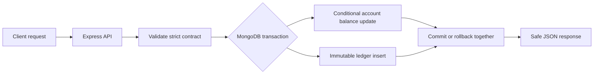

## 2. Quick start

### Prerequisites

- Node.js 20 or newer (the verification environment used Node 22.23.2).
- npm.
- Docker Desktop with Compose v2.

### Start the local replica set and API

```bash
cp .env.example .env
npm install
docker compose up -d --build
```

The Compose project is scoped to `transaction-ledger-api`. It creates one MongoDB 8 replica-set member, initializes `rs0`, and starts the API after MongoDB becomes healthy.

### Live deployment and reviewer links

The deployed API is available at [transaction-ledger-api-woad.vercel.app](https://transaction-ledger-api-woad.vercel.app/). These links are safe starting points for review:

| Resource             | Link                                                                                     |
| -------------------- | ---------------------------------------------------------------------------------------- |
| GitHub repository    | [transaction-ledger-api](https://github.com/akshaychavan23031998/transaction-ledger-api) |
| Health check         | [`GET /health`](https://transaction-ledger-api-woad.vercel.app/health)                   |
| Swagger UI           | [`/api-docs/`](https://transaction-ledger-api-woad.vercel.app/api-docs/)                 |
| Raw OpenAPI document | [`/api-docs.json`](https://transaction-ledger-api-woad.vercel.app/api-docs.json)         |

Example live health response:

```json
{
  "status": "ok",
  "database": "connected",
  "request_id": "ad077578-dfa8-46e7-80e9-11466c780cfe"
}
```

`request_id` is generated per request, so reviewers should expect a different value when they refresh the endpoint. The OpenAPI document lists the complete account, balance, transaction-history, credit/debit, and transfer contract.

Account creation is intentionally small: the client supplies a name, while the service owns identity, currency, timestamps, and the initial zero balance.

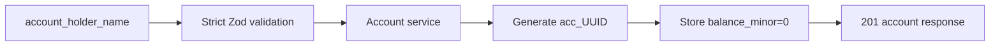

Check the service:

```bash
curl http://localhost:3000/health
open http://localhost:3000/api-docs
```

Expected health shape:

```json
{ "status": "ok", "database": "connected", "request_id": "request-generated" }
```

Initialize or verify indexes explicitly:

```bash
npm run db:init
```

Run the quality gates:

```bash
npm run typecheck
npm run lint
npm run format:check
npm run build
npm run test:unit
npm run test:integration
npm run test:concurrency
npm run test:coverage
```

The integration and concurrency suites use the local replica set and a generated database named `transaction_ledger_test_<process-id>`. Test setup explicitly defaults to the local replica-set URI before application dotenv loading, so a production `.env` cannot silently redirect tests to Atlas. Test startup rejects any non-test database name before connecting, and cleanup refuses to drop an unexpected database. The default development URI includes `directConnection=true` so a host process can use the one-node local replica set; the Compose API uses the internal `mongo` service URI.

Never run the database-backed suites with `MONGODB_DB_NAME=transaction_ledger`. The test configuration fails fast instead of risking the development database.

Stop the project without removing its persistent volume:

```bash
docker compose down
```

## 3. Architecture overview

The implementation uses feature modules and keeps financial decisions in services. Controllers translate HTTP into application calls; repositories are the only layer that knows the Mongoose models.

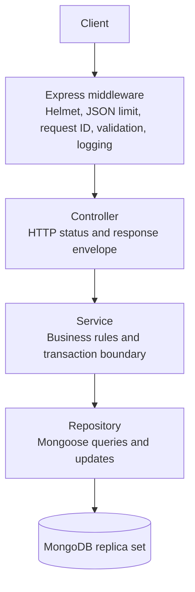

- `src/app.ts` creates the testable Express application without listening on a port.
- `src/server.ts` owns process startup, database initialization, and graceful shutdown.
- Controllers do not update balances directly.
- Services call `runInTransaction` for all financial mutations.
- Repositories do not hide balance changes in Mongoose hooks.
- MongoDB unique indexes enforce identity and idempotency at the database boundary.

## 4. Folder structure

```text
transaction-ledger-api/
├── src/
│   ├── app.ts                         # Express composition root
│   ├── server.ts                      # Production process lifecycle
│   ├── config/                        # Environment and MongoDB connection
│   ├── common/                        # Errors, middleware, logger, money, retry helper
│   ├── modules/
│   │   ├── accounts/                  # Account model, API, balance query
│   │   ├── ledger/                    # Credit/debit model, API, history query
│   │   └── transfers/                 # Optional bonus transfer flow
│   └── docs/openapi.ts                # Versioned OpenAPI contract
├── tests/
│   ├── unit/                          # Pure money and OpenAPI checks
│   ├── integration/                   # Real HTTP + real MongoDB behavior
│   ├── concurrency/                   # Parallel financial requests
│   └── helpers/                       # Replica-set lifecycle for tests
├── scripts/init-db.ts                 # Idempotent index initialization/report
├── Dockerfile
├── docker-compose.yml
├── .env.example
├── jest.config.ts
└── README.md
```

## 5. Database design

### Why both a balance and a ledger?

The account balance is a materialized current value: it makes the balance endpoint a single indexed document read. The ledger is the immutable explanation of how that value changed. The service updates both in one MongoDB transaction.

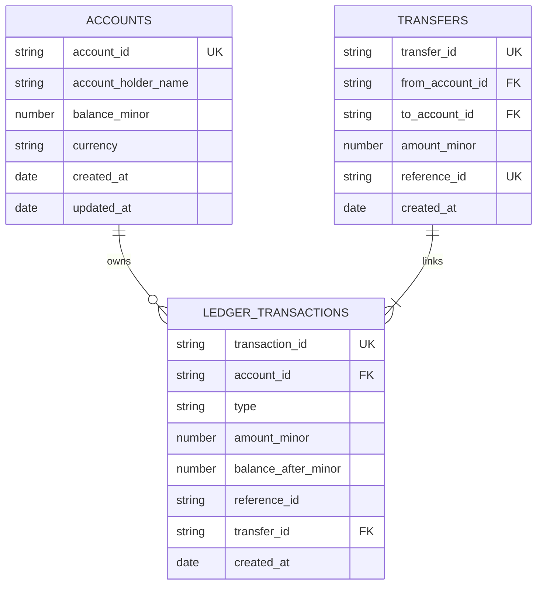

### Collection reference

| Collection            | Important fields                                                               | Constraints and indexes                                                                                                | Mutability                                                        |
| --------------------- | ------------------------------------------------------------------------------ | ---------------------------------------------------------------------------------------------------------------------- | ----------------------------------------------------------------- |
| `accounts`            | `account_id`, holder name, `balance_minor`, `currency`, timestamps             | Unique `account_id`; balance is nonnegative and capped                                                                 | Balance changes only in services; identity/currency are immutable |
| `ledger_transactions` | `transaction_id`, account, type, amount, balance-after, description, reference | Unique `transaction_id`; unique `(account_id, reference_id)`; `(account_id, created_at, transaction_id)` history index | Immutable through the public API                                  |
| `transfers`           | transfer ID, source, destination, amount, reference, description               | Unique `transfer_id`; unique `reference_id`                                                                            | Immutable through the public API                                  |

The exact schemas live in [account.model.ts](src/modules/accounts/account.model.ts), [ledger.model.ts](src/modules/ledger/ledger.model.ts), and [transfer.model.ts](src/modules/transfers/transfer.model.ts). All persisted money values are safe integer minor units; the API exposes decimal strings.

### Balance invariant

For every account, the stored balance equals the initial zero balance plus every committed credit less every committed debit. A transfer contributes one debit to the source and one credit to the destination. An uncommitted transaction contributes to neither side.

## 6. Complete API reference

All JSON API success and error responses include a `request_id` for log correlation, and the same value is returned in the `x-request-id` response header. `/api-docs` redirects to `/api-docs/` before serving Swagger UI. Mutation request bodies are strict: unknown fields are rejected.

| Method | Route                                      | Purpose                               | Success             |
| ------ | ------------------------------------------ | ------------------------------------- | ------------------- |
| `GET`  | `/health`                                  | Process/database status               | `200`               |
| `POST` | `/api/v1/accounts`                         | Create a zero-balance account         | `201`               |
| `GET`  | `/api/v1/accounts/:accountId/balance`      | Read current balance                  | `200`               |
| `GET`  | `/api/v1/accounts/:accountId/transactions` | Filtered, paginated history           | `200`               |
| `POST` | `/api/v1/transactions`                     | Atomic credit or debit                | `201`, replay `200` |
| `POST` | `/api/v1/transfers`                        | Atomic source-to-destination transfer | `201`, replay `200` |
| `GET`  | `/api-docs/`                               | Swagger UI                            | `200`               |
| `GET`  | `/api-docs.json`                           | Raw OpenAPI JSON                      | `200`               |

### Create account

```bash
curl -X POST http://localhost:3000/api/v1/accounts \
  -H 'content-type: application/json' \
  -d '{"account_holder_name":"Ada Lovelace"}'
```

The server generates the account ID and forces `balance` to `"0.00"`; clients cannot supply a starting balance.

### Credit or debit

```bash
curl -X POST http://localhost:3000/api/v1/transactions \
  -H 'content-type: application/json' \
  -d '{"account_id":"acc_example","type":"credit","amount":"100.00","description":"Funding","reference_id":"funding-001"}'
```

`amount` must be a positive decimal string with at most two fractional digits. `reference_id` is unique per account. An identical retry returns `200` with `idempotent_replay: true`; a different payload using the same reference returns `409 IDEMPOTENCY_CONFLICT`.

```json
{
  "success": true,
  "data": {
    "transaction_id": "txn_generated",
    "account_id": "acc_example",
    "type": "credit",
    "amount": "100.00",
    "balance": "100.00",
    "description": "Funding",
    "reference_id": "funding-001",
    "idempotent_replay": false
  },
  "request_id": "request-generated"
}
```

### Balance

```bash
curl http://localhost:3000/api/v1/accounts/acc_example/balance
```

### History

```bash
curl 'http://localhost:3000/api/v1/accounts/acc_example/transactions?type=credit&page=1&limit=20'
```

The default includes both types. Results are sorted by `created_at DESC, transaction_id DESC`, making ties deterministic.

### Transfer

```bash
curl -X POST http://localhost:3000/api/v1/transfers \
  -H 'content-type: application/json' \
  -d '{"from_account_id":"acc_source","to_account_id":"acc_destination","amount":"25.50","description":"Payment","reference_id":"transfer-001"}'
```

The transfer rejects the same account, missing accounts, insufficient funds, and destination overflow. Its reference is globally idempotent, and the response lists both linked ledger transaction IDs.

## 7. Journey of a credit transaction

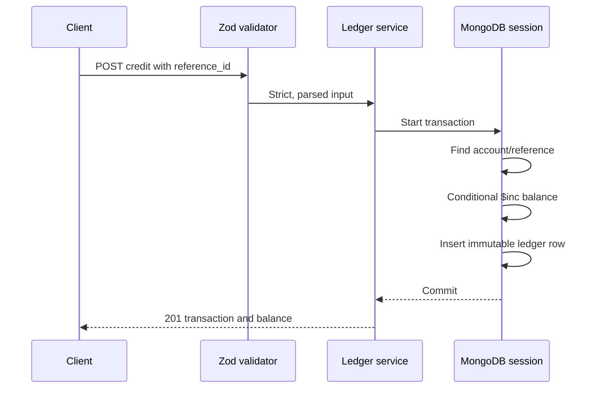

If the account update or ledger insert fails, `withTransaction` aborts the whole unit. A transient transaction error gets a bounded retry; a business error such as a missing account does not.

## 8. Journey of a debit transaction

The debit condition is part of the database update, not only an application read.

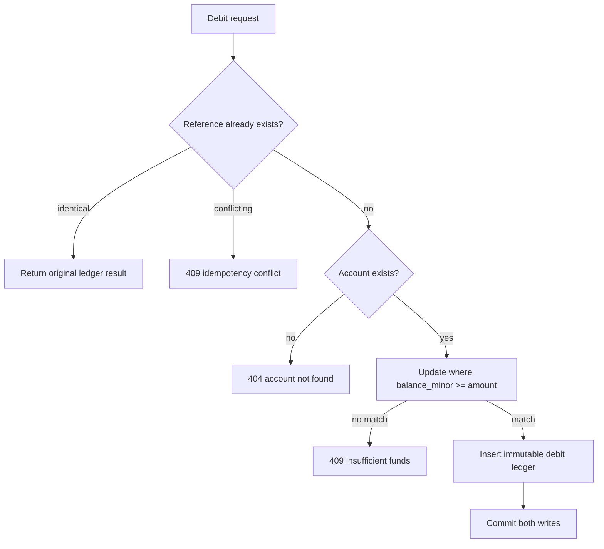

Two requests cannot both pass a stale read and subtract the same money because the `$gte` predicate is evaluated by MongoDB during the write.

## 9. How duplicate prevention works

Suppose a client sends a credit, times out, and sends it again. The first request stores the ledger row and balance update in one transaction. The second request finds the same `(account_id, reference_id)` and compares the business fields.

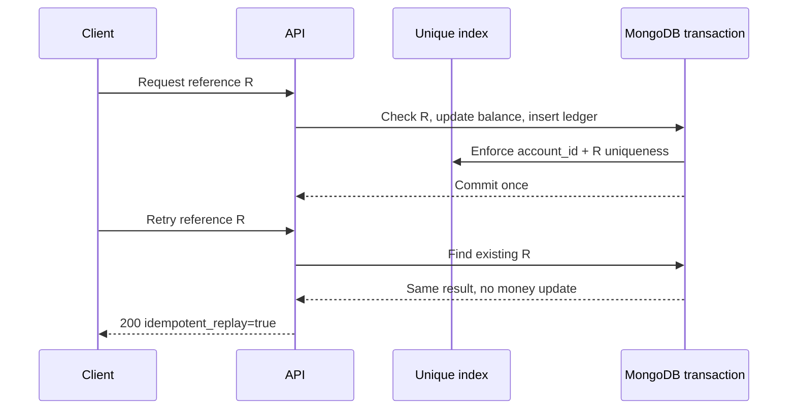

The unique index is the authority. An in-memory set is not used, so multiple API processes still share the same idempotency rule.

## 10. How atomicity works

Without a transaction, the application could update the balance and then fail before writing history. That would create money with no explanation. MongoDB transactions prevent this partial effect.

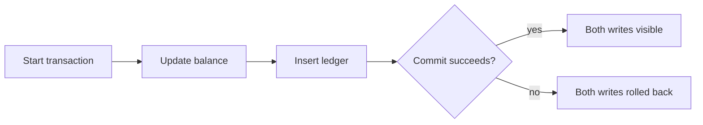

The same boundary contains all four writes in a transfer: source balance, destination balance, transfer record, and two ledger records.

## 11. How concurrency works

Starting balance: `100.00`. Request A and Request B each try to debit `80.00`.

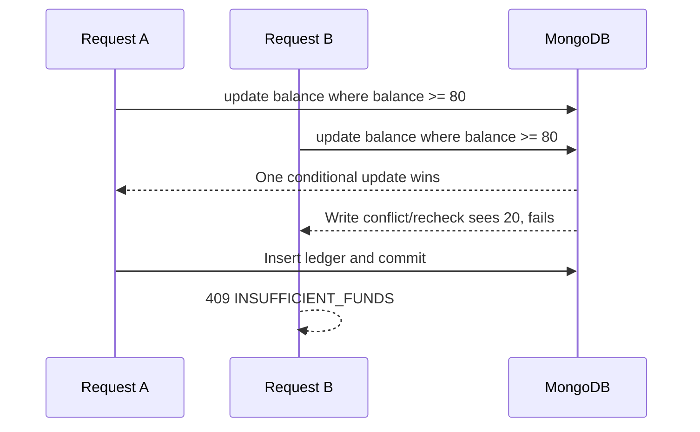

The concurrency test sends requests with `Promise.all`, not a sequential loop. It verifies one success and a final balance of `20.00`. Transaction retries are bounded by `TRANSACTION_RETRY_ATTEMPTS` (default `3`).

## 12. Transaction history and pagination

History accepts `type=credit|debit`, `page` (default `1`), and `limit` (default `20`, maximum `100`).

```mermaid
flowchart LR
    Request[accountId + filters] --> Query[Indexed account history query]
    Query --> Sort[created_at DESC, transaction_id DESC]
    Sort --> Slice[skip=(page-1)*limit, limit]
    Slice --> Response[data + pagination metadata]
```

Example metadata:

```json
{ "page": 1, "limit": 20, "total_records": 47, "total_pages": 3 }
```

The history index starts with `account_id`, matching the required account scope before sorting by creation time.

Page `1` with limit `2` means records `1..2`; page `2` means records `3..4`. `total_pages` is calculated from the total matching records, not only the current page.

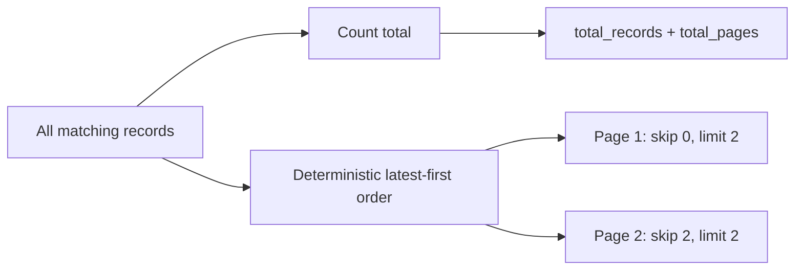

## 13. Account-to-account transfer

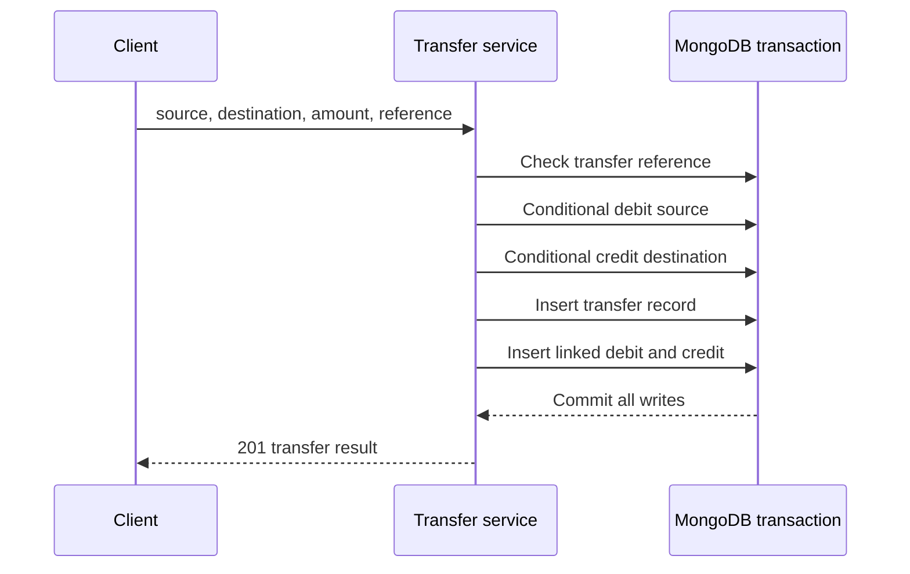

If any step fails, the entire transfer is rolled back. A retry with the same reference returns the already committed transfer; a different payload returns an idempotency conflict.

## 14. Money precision

JavaScript `0.1 + 0.2` is not exactly `0.3` in binary floating-point. The API therefore accepts decimal strings and converts them once at the boundary:

| API value  | Stored `amount_minor` |
| ---------- | --------------------: |
| `"100.00"` |               `10000` |
| `"25.50"`  |                `2550` |
| `"0.01"`   |                   `1` |

The supported precision is two decimal places. Zero, negative values, malformed strings, scientific notation, `NaN`, infinity, and values above `9,999,999,999,999` minor units are rejected. The maximum is below JavaScript's unsafe-integer boundary.

Conversion is centralized in [money.ts](src/common/utils/money.ts), and responses consistently format minor units back to two-decimal strings.

## 15. Validation and error handling

Zod schemas reject unexpected fields and validate body, route parameters, and query parameters before controllers run.

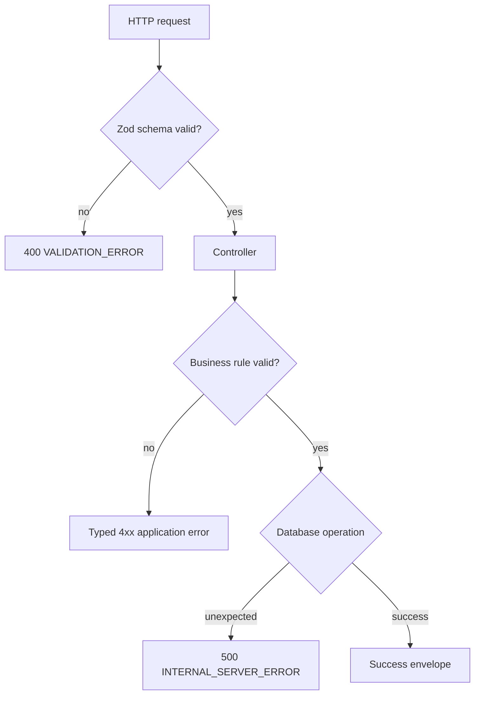

Known error codes include `VALIDATION_ERROR`, `ACCOUNT_NOT_FOUND`, `INVALID_AMOUNT`, `INSUFFICIENT_FUNDS`, `DUPLICATE_REFERENCE`, `IDEMPOTENCY_CONFLICT`, `TRANSFER_NOT_ALLOWED`, `DATABASE_UNAVAILABLE`, `NOT_FOUND`, and `INTERNAL_SERVER_ERROR`. Raw stack traces and database payloads are not returned.

## 16. Swagger walkthrough

Swagger UI is available at [http://localhost:3000/api-docs](http://localhost:3000/api-docs), and the raw contract is available at `/api-docs.json`. The source of truth is [openapi.ts](src/docs/openapi.ts), and Jest tests validate both the OpenAPI 3 document and the executable Swagger UI assets. The OpenAPI server is relative to the current origin, so the same documentation works locally and on Vercel.

Open Swagger, select `POST /api/v1/accounts`, create an account, copy its generated ID into a transaction request, and then use the balance/history operations. Swagger examples use the same decimal-string contract as the runtime validator.

## 17. Testing strategy

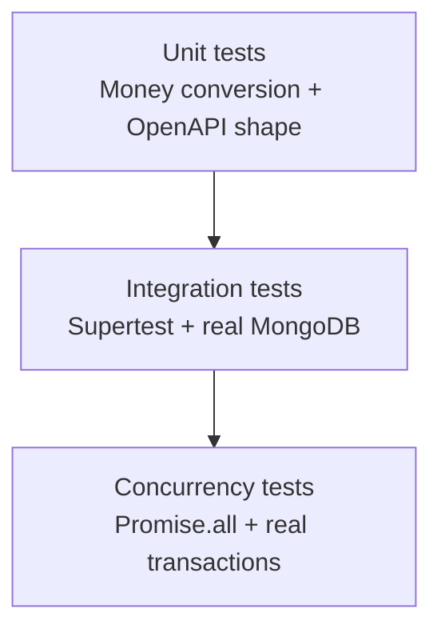

| Suite       | Command                    | What it proves                                                   |
| ----------- | -------------------------- | ---------------------------------------------------------------- |
| Unit        | `npm run test:unit`        | Exact money boundaries and OpenAPI validation                    |
| Integration | `npm run test:integration` | HTTP contracts, transactions, idempotency, transfers, pagination |
| Concurrency | `npm run test:concurrency` | Parallel duplicate requests, parallel debits, parallel credits   |
| Coverage    | `npm run test:coverage`    | Combined behavior and coverage report in `coverage/`             |

Integration and concurrency tests drop only the generated `transaction_ledger_test_<process-id>` database between cases and recreate indexes. Safety assertions check `NODE_ENV`, the test-name pattern, and the active Mongo database before every cleanup. They require the transaction-capable Docker MongoDB environment; financial rollback and concurrency guarantees use real MongoDB transactions rather than mocks. Test-only fault injection is available only when `NODE_ENV=test` and is used to prove rollback boundaries.

## 18. Docker and MongoDB replica set

MongoDB multi-document transactions require a replica set or sharded cluster. Local Compose starts a single-member replica set named `rs0`; a single member is enough to exercise transaction semantics locally.

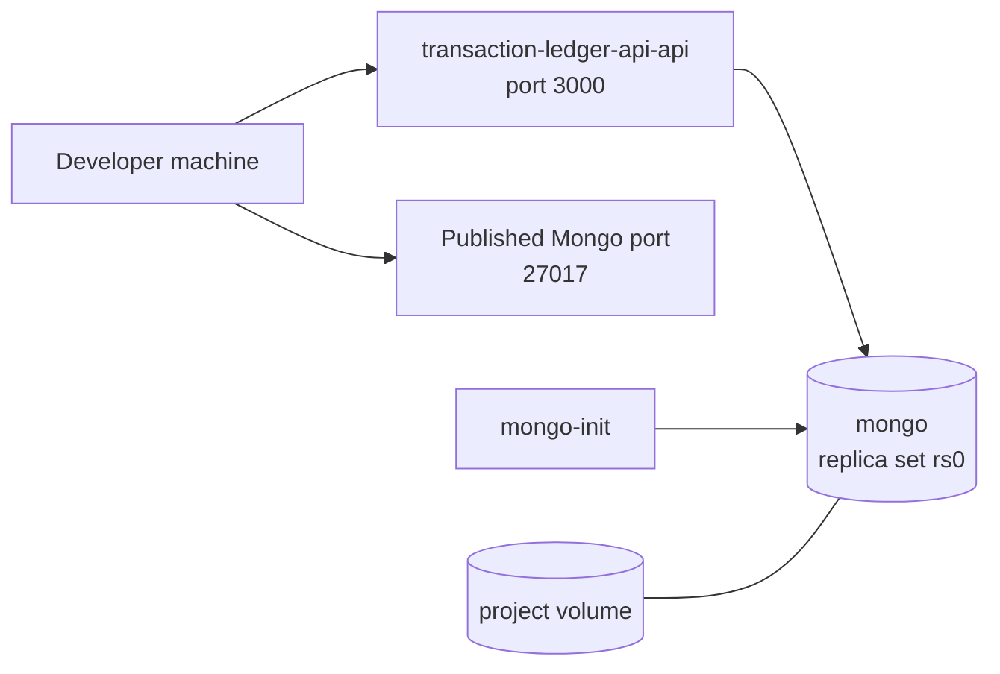

Resources are named through the Compose project and the volume is `transaction-ledger-api_transaction-ledger-mongo-rs-data`; no global Docker cleanup is required.

The local Compose setup intentionally runs MongoDB without authentication because it is bound to the developer machine for this assessment. It does not define unused root-credential variables. `extra_hosts` maps `host.docker.internal` to the host gateway for Docker Desktop and Linux Docker Engine compatibility. Production requires authenticated MongoDB, private networking, and managed backups.

## 19. Database indexes and migrations

`npm run db:init` connects to MongoDB, calls `createIndexes()` for the three models, and prints the actual database index definitions. The operation is idempotent and non-destructive.

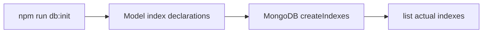

Required indexes:

- `accounts.account_id` unique.
- `ledger_transactions.transaction_id` unique.
- `ledger_transactions.(account_id, reference_id)` unique.
- `ledger_transactions.(account_id, created_at, transaction_id)` for deterministic history.
- `transfers.transfer_id` unique.
- `transfers.reference_id` unique.

This project uses explicit index initialization rather than pretending MongoDB needs SQL migrations. Future schema changes should be additive and backward compatible where possible. Index removals or destructive data migrations need a separately reviewed, versioned migration; rollback is not automatic.

Ledger reconciliation compares the stored account balance with the sum of committed ledger deltas. The service records `balance_after_minor` on each entry, which makes an unexpected divergence diagnosable without rewriting history.

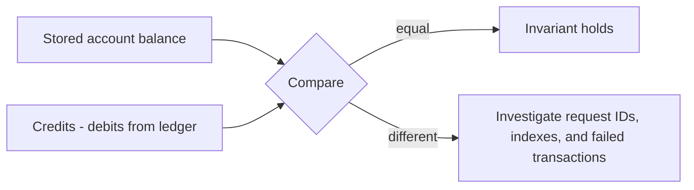

## 20. Security and observability

- Helmet sets baseline secure response headers.
- JSON request bodies are limited to 32 KB.
- Zod rejects malformed and unexpected input.
- Error responses are sanitized.
- `X-Request-Id` is accepted only when it matches a safe character set; otherwise a UUID is generated.
- Pino emits structured request and failure logs with method, route, status, duration, request ID, and error code.
- Secrets are not hardcoded; `.env` is ignored and `.env.example` contains only safe local defaults, never credentials.

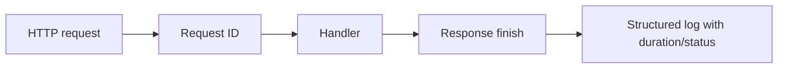

Authentication and authorization are intentionally not implemented. This assessment API must not be exposed publicly as a real financial service until access control, rate limiting, operational monitoring, secret management, and deployment hardening are added.

## 21. Engineering decisions

| Problem                             | Chosen approach                                     | Reason                                                                      | Trade-off                                        |
| ----------------------------------- | --------------------------------------------------- | --------------------------------------------------------------------------- | ------------------------------------------------ |
| Document-oriented transaction state | MongoDB + Mongoose                                  | Natural fit for the assessment and supports transactions with a replica set | Requires replica-set setup locally               |
| Exact money                         | Integer minor units                                 | No floating-point rounding                                                  | Caller-facing conversion is required             |
| Fast balances                       | Stored account balance plus ledger                  | O(1) balance reads plus audit history                                       | Every mutation must update both consistently     |
| Partial writes                      | MongoDB transactions                                | Balance and ledger commit together                                          | Transaction overhead and replica-set requirement |
| Idempotency                         | Compound unique index and replay comparison         | Works across processes and survives restarts                                | Reference reuse must be handled explicitly       |
| Architecture                        | Feature modules with explicit repositories/services | Easy to trace financial flow                                                | More files than a single controller              |
| Validation                          | Strict Zod schemas                                  | Clear boundary and safe errors                                              | Schemas must be maintained with OpenAPI          |
| API exploration                     | Hand-maintained OpenAPI + Swagger UI                | Reviewable contract and runnable docs                                       | Contract drift must be tested/reviewed           |
| Verification                        | Unit + real database integration + concurrency      | Tests behavior and real transaction semantics                               | Requires Docker for the strongest suites         |

## 22. Assumptions and limitations

- One currency (`USD`) is used for this assessment.
- API amounts support two decimal places.
- No authentication or authorization is included.
- No external payment gateway or banking integration exists.
- The local database is one MongoDB replica-set member; production would need a properly sized deployment.
- The API is a single process and does not claim distributed production readiness.
- Public APIs do not expose update/delete operations for ledger records.
- Transfer idempotency is global by `reference_id`; credit/debit idempotency is scoped by account.

## 23. Assignment requirement mapping

| Requirement                              | Status          | Source                                          | Evidence                               |
| ---------------------------------------- | --------------- | ----------------------------------------------- | -------------------------------------- |
| Account creation and forced zero balance | PASS            | `src/modules/accounts/*`                        | Integration account test               |
| Credit/debit APIs                        | PASS            | `src/modules/ledger/*`                          | Integration transaction test           |
| Balance endpoint                         | PASS            | `account.service.ts` and routes                 | Integration balance checks             |
| Filtered/paginated history               | PASS            | `ledger.service.ts`                             | Integration history test               |
| Integer minor units                      | PASS            | `src/common/utils/money.ts`                     | Unit money tests                       |
| Atomic MongoDB transactions              | PASS            | `retryTransaction.ts`, ledger/transfer services | Integration + Docker replica set       |
| Conditional debit concurrency safety     | PASS            | `account.repository.ts`                         | Concurrency debit test                 |
| Database idempotency                     | PASS            | Compound ledger index and transfer index        | Replay/conflict/concurrent tests       |
| Bonus transfers                          | PASS            | `src/modules/transfers/*`                       | Integration transfer test              |
| Strict validation/errors                 | PASS            | schemas, middleware, errors                     | Validation integration test            |
| Swagger/OpenAPI                          | PASS            | `src/docs/openapi.ts`, `app.ts`                 | OpenAPI unit and endpoint checks       |
| Docker replica set                       | PASS            | `docker-compose.yml`                            | Compose config and container health    |
| Explicit index initialization            | PASS            | `scripts/init-db.ts`                            | `npm run db:init` final check          |
| Structured logs/request IDs              | PASS            | common logger/middleware                        | Integration response header/log output |
| Authentication/authorization             | NOT IMPLEMENTED | Documented limitation                           | Intentionally outside scope            |

## 24. Troubleshooting

### MongoDB connection failure

```bash
docker compose ps
docker compose logs mongo
docker compose up -d
```

The host test URI uses `directConnection=true` for the one-node local replica set. The Compose API uses the internal Mongo service URI.

### Replica set not initialized

```bash
docker compose up -d mongo
docker compose run --rm mongo-init
docker compose up -d api
```

### Port already in use

Change the host-side ports in a local, uncommitted override or stop the process using `3000`/`27017`. Do not use global Docker cleanup commands.

### Index initialization failure

```bash
npm run db:init
docker compose logs mongo
```

Check that the URI points at the writable primary and that the database name is correct.

### Test failure

Start MongoDB first, then run one suite:

```bash
MONGODB_URI='mongodb://localhost:27017/transaction_ledger?replicaSet=rs0&directConnection=true' npm run test:integration
```

The URI selects the server; the test setup supplies a safe per-run database name. If `MONGODB_DB_NAME` is set to the development database or another non-test name, Jest exits before opening a connection.

### Swagger does not load

Verify `/api-docs.json` first, then verify that `/api-docs/swagger-ui.css`, `/api-docs/swagger-ui-bundle.js`, `/api-docs/swagger-ui-standalone-preset.js`, and `/api-docs/swagger-ui-init.js` return their correct content types. Vercel includes `node_modules/swagger-ui-dist/**` through `vercel.json`, and the Express app explicitly serves the three static assets before the Swagger fallback handler. If an asset returns `text/html`, the browser will show a blank UI; redeploy and perform a hard refresh.

## 25. Final verification report

This section is maintained from actual commands run in the repository. It must not be read as a cloud deployment claim.

| Check                                         | Result                                              |
| --------------------------------------------- | --------------------------------------------------- |
| Repository path and Git-root isolation        | PASS                                                |
| `npm run typecheck`                           | PASS                                                |
| `npm run lint`                                | PASS                                                |
| `npm run format:check`                        | PASS                                                |
| `npm run build`                               | PASS                                                |
| `npm run test:unit`                           | PASS — 16 tests                                     |
| `npm run test:integration`                    | PASS — 23 tests                                     |
| `npm run test:concurrency`                    | PASS — 6 tests                                      |
| `npm run test:coverage`                       | PASS — 45 tests; 95.05% statements, 94.86% lines    |
| `npm run db:init` and actual index inspection | PASS — expected unique and history indexes observed |
| `npm audit --omit=dev --audit-level=high`     | PASS — 0 high-or-higher production vulnerabilities  |
| `docker compose config`                       | PASS                                                |
| Docker MongoDB replica set                    | PASS — primary observed                             |
| Docker API health endpoint                    | PASS — `database: connected`                        |
| Raw OpenAPI endpoint                          | PASS                                                |

The table records repository-local verification. Production smoke checks should be rerun after each deployment because Vercel packaging and environment variables are external to the local test process. The final audit command could not contact `registry.npmjs.org`; dependency vulnerability status should be refreshed in a network-enabled CI environment before publishing.

## 26. Future improvements

- Add authentication, authorization, tenant isolation, and audit permissions.
- Add rate limiting and abuse controls.
- Add production MongoDB topology, backups, alerting, and operational dashboards.
- Add cursor-based pagination for very large ledgers.
- Add multi-currency accounts with explicit FX rules.
- Add reconciliation jobs and invariant alarms.
- Add a formal versioned migration runner for future schema/data changes.
- Add API client SDKs and generated contract checks in CI.
